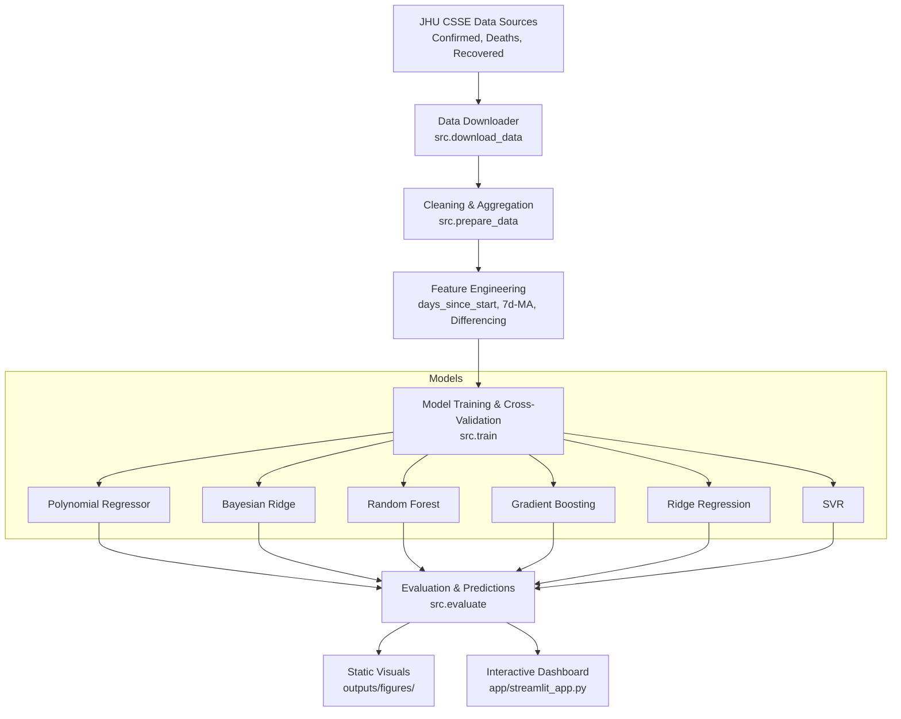
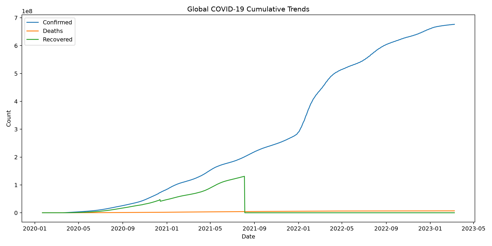
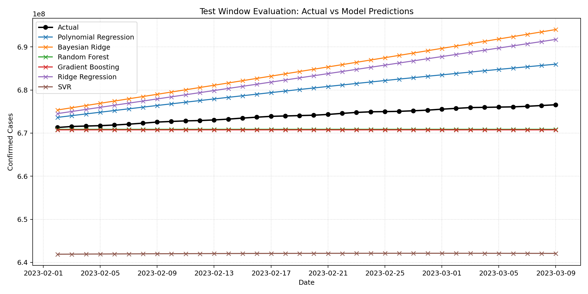
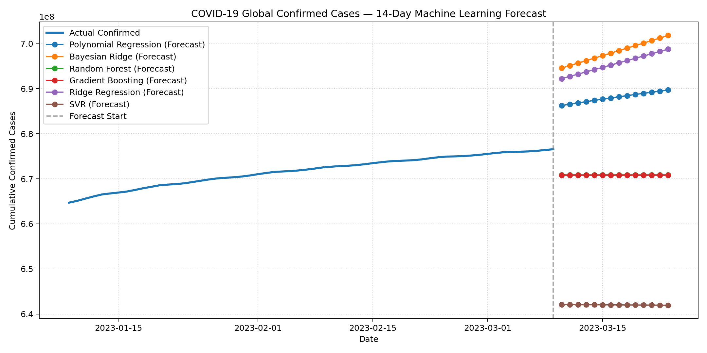

# 🦠 COVID-19 Case Forecasting & Intelligent Analytics

<p align="center">
  
  
  
  
  
</p>

<p align="center">
  <b>An end-to-end Machine Learning and Time-Series Analytics platform to monitor, visualize, and forecast global and country-level COVID-19 trajectories using multi-model regression architectures.</b>
</p>

---

## 📌 Table of Contents

- [Overview](#-overview)
- [Key Features](#-key-features)
- [System Architecture](#-system-architecture)
- [Model Benchmark & Evaluation](#-model-benchmark--evaluation)
- [Interactive Dashboard Preview](#-interactive-dashboard-preview)
- [Project Directory Structure](#-project-directory-structure)
- [Quick Start Guide](#-quick-start-guide)
  - [Prerequisites](#prerequisites)
  - [Installation & Setup](#installation--setup)
  - [Launching the Dashboard](#launching-the-dashboard)
- [Pipeline Execution](#-pipeline-execution)
- [Methodology & Technical Details](#-methodology--technical-details)
- [Limitations & Disclaimer](#-limitations--disclaimer)
- [License & Author](#-license--author)

---

## 🔬 Overview

Forecasting pandemic trajectories requires scalable data ingestion, robust feature engineering, and rigorous benchmarking across statistical and non-linear machine learning models. 

This repository implements a production-grade time-series forecasting pipeline using historical data from the **Johns Hopkins University Center for Systems Science and Engineering (JHU CSSE)**. The project compares 6 different regression algorithms, evaluates performance across multiple metrics (MAE, MSE, RMSE, TimeSeries Cross-Validation), generates short-horizon forecasts with prediction intervals, and surfaces insights through a responsive **Streamlit** dashboard.

---

## ✨ Key Features

- **Automated Data Pipeline (ETL)**: Automatically fetches, cleans, and standardizes global confirmed, recovered, and death time-series records from JHU CSSE.
- **Multi-Model Regression Suite**:
  - **Random Forest Regressor** (Ensemble Bagging)
  - **Gradient Boosting Regressor** (Ensemble Boosting)
  - **Polynomial Regression** (Degree 3)
  - **Ridge Regression** (L2 Regularized Polynomial)
  - **Bayesian Ridge Regression** (Probabilistic Bayesian Prior)
  - **Support Vector Regression (SVR)** (Radial Basis Function Kernel)
- **Time-Series Cross-Validation**: Validates temporal generalizability using forward-chaining cross-validation (`TimeSeriesSplit`) without lookahead bias.
- **Short-Horizon Projections**: Generates 14-day forecasts along with statistical uncertainty / confidence bounds.
- **Interactive Streamlit Web Dashboard**:
  - Global vs. Country-level granular analysis (US, UK, India, Pakistan, Germany, etc.).
  - 7-day rolling moving averages to eliminate reporting noise.
  - Dynamic model selection and comparison sliders.
  - Linear vs. Logarithmic scale toggles for epidemiological wave inspection.
- **Modular & Tested**: Clean Python architecture (`src/`), unit tests via `pytest`, and build automation with `Makefile`.

---

## 🏛️ System Architecture



---

## 📊 Model Benchmark & Evaluation

All models were evaluated on an out-of-sample holdout test set as well as cross-validated across rolling temporal splits:

| Model | Test MAE | Test RMSE | Mean CV MAE | Mean CV RMSE | Status |
| :--- | :---: | :---: | :---: | :---: | :---: |
| 🌲 **Random Forest** | **3,202,555** | **3,568,557** | 5,670,239 | 6,400,787 | 🥇 Top Performer |
| ⚡ **Gradient Boosting** | **3,292,150** | **3,649,177** | 5,561,136 | 6,305,000 | 🥈 Strong Baseline |
| 📈 **Polynomial Regression (Deg 3)** | 6,051,004 | 6,405,946 | 2,552,146 | 2,963,987 | 🥉 Best Trend Curvature |
| 📉 **Ridge Regression** | 9,010,913 | 9,681,223 | **1,333,587** | **1,471,734** | Regularized Linear |
| 🎲 **Bayesian Ridge** | 10,526,330 | 11,251,311 | 1,367,883 | 1,545,817 | Probabilistic |
| 🎯 **Support Vector Regression (SVR)** | 32,011,974 | 32,047,953 | 20,062,605 | 20,339,610 | Non-linear Baseline |

> **Key Finding**: Ensemble methods (**Random Forest** and **Gradient Boosting**) delivered the lowest error on the recent holdout window, while **Polynomial Regression** effectively captured long-range macroscopic inflection points.

---

## 🖼️ Visualizations & Model Previews

### 1. Global Historical Pandemic Trends
<p align="center">
  
</p>

### 2. Multi-Model Benchmark Comparison
<p align="center">
  
</p>

### 3. Model Projections & Forecasting
<p align="center">
  
</p>

---

## 📂 Project Directory Structure

```text
covid-19-forecasting/
├── app/
│   └── streamlit_app.py            # Interactive Streamlit Web Application
├── data/
│   ├── raw/                        # Raw JHU CSSE time-series CSVs
│   └── processed/                  # Aggregated global & country datasets
├── models/                         # Serialized trained model weights (.joblib)
├── notebooks/
│   └── covid19_case_forecasting.ipynb # Exploratory Data Analysis & experiments
├── outputs/
│   ├── figures/                    # Exported high-res visualizations
│   └── predictions/                # Evaluation metrics & forecast CSV outputs
├── src/
│   ├── __init__.py
│   ├── config.py                   # Central directory & pipeline configs
│   ├── download_data.py            # Automated JHU CSSE downloader
│   ├── prepare_data.py             # Preprocessing & feature extraction
│   ├── models.py                   # Model architecture definitions
│   ├── train.py                    # Training & cross-validation pipeline
│   ├── evaluate.py                 # Metric calculators (MAE, MSE, RMSE)
│   └── visualize.py                # Visual reporting & plotting utilities
├── tests/
│   └── test_pipeline.py            # Automated pytest unit test suite
├── Makefile                        # CLI shortcut automation
├── requirements.txt                # Production dependencies
└── README.md                       # Project documentation
```

---

## 🚀 Quick Start Guide

### Prerequisites
- Python 3.10+ (tested up to Python 3.14)
- Git

### Installation & Setup

1. **Clone the repository:**
   ```bash
   git clone https://github.com/httpstalha/covid-19-forecasting.git
   cd covid-19-forecasting
   ```

2. **Create and activate a virtual environment:**
   ```bash
   # Linux / macOS
   python3 -m venv .venv
   source .venv/bin/activate

   # Windows
   python -m venv .venv
   .venv\Scripts\activate
   ```

3. **Install dependencies:**
   ```bash
   pip install --upgrade pip
   pip install -r requirements.txt
   ```

### Launching the Dashboard

Run the Streamlit application with:

```bash
streamlit run app/streamlit_app.py
```

Open your browser at **`http://localhost:8501`** to explore the dashboard.

---

## ⚙️ Pipeline Execution

You can run individual pipeline stages either using Python modules or via `make`:

| Stage | Command | Make Target | Description |
| :--- | :--- | :--- | :--- |
| **Download Data** | `python -m src.download_data` | `make data` | Fetches newest time-series CSVs from JHU |
| **Prepare Data** | `python -m src.prepare_data` | `make data` | Cleans & computes temporal features |
| **Train Models** | `python -m src.train` | `make train` | Trains 6 ML models & exports metrics |
| **Generate Visuals**| `python -m src.visualize` | `make visualize`| Generates static trend figures |
| **Run Unit Tests** | `pytest -q` | `make test` | Executes pipeline validation tests |
| **Start Dashboard** | `streamlit run app/streamlit_app.py` | `make dashboard` | Launches interactive dashboard |

---

## 🧠 Methodology & Technical Details

1. **Temporal Indexing**: Cumulative time series are converted into an elapsed time index (`days_since_start`), allowing regression models to extrapolate progression.
2. **Noise Reduction**: Reporting delays and weekend variations are smoothed using a 7-day rolling window:
   $$\text{SMA}_7(t) = \frac{1}{7} \sum_{i=0}^{6} y_{t-i}$$
3. **Leakage Prevention**: Validation utilizes sequential time-series splits (`TimeSeriesSplit`) so future observations never leak into historical training steps.
4. **Ensemble & Polynomial Formulation**: Non-linear growth phases are modeled both through third-degree polynomial feature expansions ($\phi(x) = [1, x, x^2, x^3]$) and decision-tree ensemble variance-reduction methods.

---

## ⚠️ Limitations & Disclaimer

- **Educational & Statistical Scope**: Cumulative case modeling is a statistical projection method. It does not replace compartmental epidemiological modeling (such as SEIR models) and does not account for vaccine distribution, government policy interventions, viral variants, or behavioral dynamics.
- **Data Source**: Historical data reflects the official Johns Hopkins CSSE repository archived in March 2023.

---

## 👤 Author & Contributions

Created and maintained by **Talha Mazhar**:
- GitHub: [@httpstalha](https://github.com/httpstalha)
- Repository: [covid-19-forecasting](https://github.com/httpstalha/covid-19-forecasting)

Contributions, feature requests, and suggestions are welcome! Feel free to open an issue or submit a Pull Request.

---

## 📄 License

This project is licensed under the [MIT License](LICENSE).
